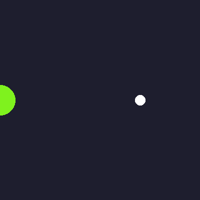

# Create a GIF with Python

Projeto do [Codédex](https://www.codedex.io/projects/create-a-gif-with-python): gerar um GIF animado usando apenas Python e a biblioteca [Pillow](https://pillow.readthedocs.io/).



## O que o projeto faz

O script `create_gif.py` desenha 40 quadros (frames) de 400x400 pixels e os junta em um único GIF animado, `animation.gif`. A animação tem:

- uma **bola colorida** que atravessa a tela da esquerda para a direita, subindo e descendo em onda, e cuja cor muda a cada quadro;
- um **ponto branco** que gira em círculo ao redor do centro da imagem.

## Como funciona

1. `make_frame(i)` cria uma imagem em branco (`Image.new`) e desenha as formas com `ImageDraw`.
2. A posição de cada quadro depende do tempo `t = i / FRAMES` (de 0 a 1):
   - o eixo Y da bola usa `math.sin`, o que cria o movimento de onda;
   - as cores R, G e B usam `sin` com defasagens diferentes, o que cria a mudança suave de cor;
   - o ponto girando usa `cos` para X e `sin` para Y, o que desenha um círculo.
3. Como `t` vai de 0 a 1, o último quadro volta ao estado do primeiro e a animação se repete sem "pulo".
4. Os quadros são salvos com `frames[0].save(..., save_all=True, append_images=frames[1:])`:
   - `duration=50` define 50 ms por quadro (cerca de 20 FPS);
   - `loop=0` faz o GIF repetir para sempre.

## Como rodar

Requisito: Python 3.8 ou superior.

```bash
pip install -r requirements.txt
python create_gif.py
```

O arquivo `animation.gif` será criado na mesma pasta. Abra-o no navegador para ver a animação.

## Personalizando

No topo de `create_gif.py` você pode mudar:

| Variável | Efeito |
| --- | --- |
| `WIDTH`, `HEIGHT` | tamanho do GIF |
| `FRAMES` | quantidade de quadros (mais quadros = animação mais suave e longa) |
| `BALL_RADIUS` | tamanho da bola |

Em `frames[0].save(...)`, o parâmetro `duration` controla a velocidade.

## Arquivos

- `create_gif.py`: código que gera o GIF
- `animation.gif`: resultado
- `requirements.txt`: dependências
